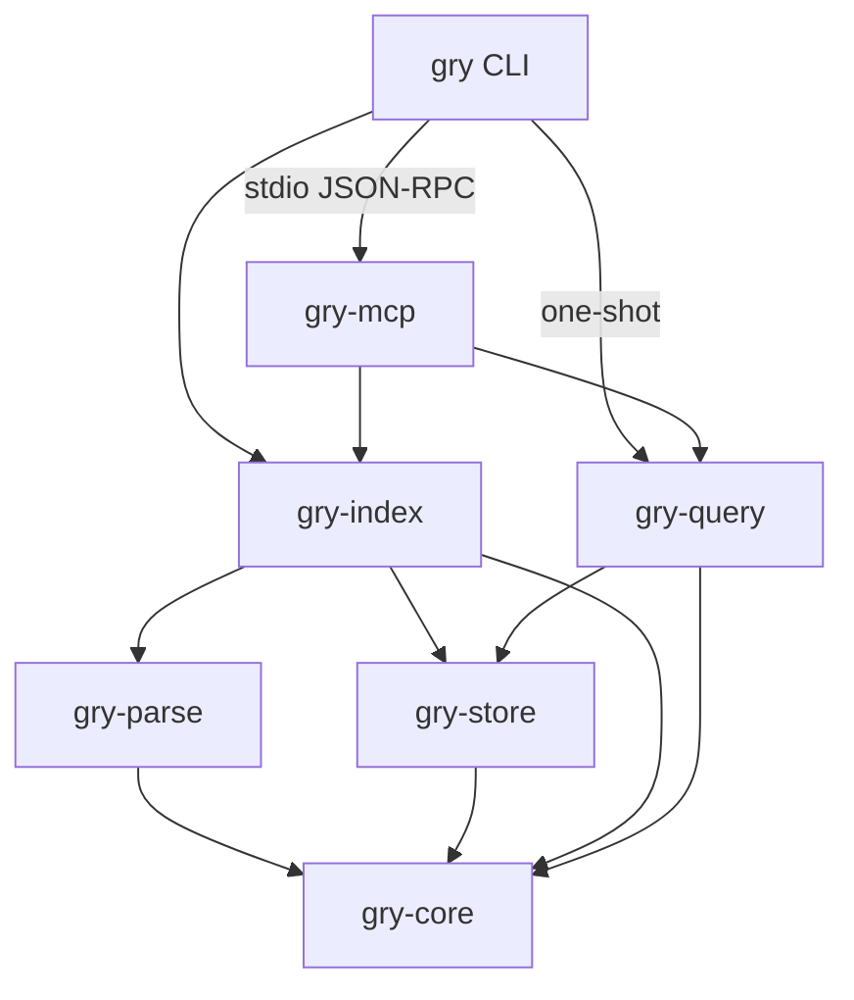
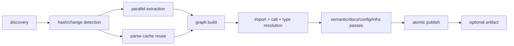

# Architecture

gry is a modular monolith: one binary, one SQLite database, no daemon and no network dependency at
runtime. This document describes how the implementation works, the contracts it preserves and the
resource bounds it targets.

Feature coverage and known limits are in [CAPABILITIES.md](CAPABILITIES.md); measured numbers are in
[BENCHMARKS.md](BENCHMARKS.md).

## 1. System shape

| Crate | Responsibility |
|---|---|
| `gry-core` | Domain nodes/edges/labels, QN rules, language table, config/settings, tokenization, MinHash, AST profile, Nomic vectors, errors |
| `gry-parse` | Statically linked tree-sitter grammars, extraction, docs/config/infra analyzers, lexical fallback |
| `gry-store` | SQLite schema/migrations, CRUD, FTS5/BM25, traversal primitives, coverage/traces/ADR, artifact export/import |
| `gry-index` | Discovery, parallel extraction, parse cache, graph building/resolution, semantic passes, publication, jobs, watcher, cross-repo |
| `gry-query` | Search/snippets/outlines, trace, architecture, schema, compare, Cypher, impact, test impact, ADR, traces |
| `gry-mcp` | Tool schemas/profiles, JSON-RPC transport, handlers, prompts, output budgeting |
| `gry` | `gry` binary: commands, one-shot tool invocation, install/uninstall, async worker, test-impact CLI |

Domain logic does not depend on the MCP transport or CLI presentation. There is one node/edge model
and one graph implementation.

## 2. Design principles

1. **Do the least work necessary.** Unchanged files are short-circuited, private edits skip edge
   work, and queries compute only the aggregates their answer needs.
2. **Preserve the evidence.** Results carry file path, source range, symbol identity and
   relationship provenance. Resolution records `confidence` and `resolved_by`.
3. **Be honest about uncertainty.** Ambiguous or unresolved references stay unresolved instead of
   becoming false edges. Coverage gaps and unsupported constructs are reported.
4. **Fail without lying.** A failed or cancelled index leaves the previous generation queryable and
   never reports success for a partial publication.
5. **Bound all work.** Worker pools, result pages, traversal depth, output tokens and index run
   limits are explicit and configurable.
6. **No hidden runtime.** No daemon, no hosted service, no model download, no telemetry.

## 3. Persistence model

One SQLite database holds all projects. Project isolation is enforced by a `project` column and by
every query path, which keeps cross-repo comparison and linking simple.

Core tables:

- `projects` — name, root, generation, mode, file/source counts, index version.
- `file_hashes` — SHA-256, mtime, size; drives incremental detection.
- `nodes` — `UNIQUE(project, qualified_name)`, label/name/file/lines/properties/docstring.
- `edges` — `UNIQUE(source_id, target_id, type, local_name_gen)`, generated `url_path_gen` and
  `local_name_gen`, properties merged on duplicate.
- `project_summaries` — ADR content.
- `index_coverage` / `index_coverage_meta` — skipped and partially parsed files, generation metadata.
- `observed_calls` / `observed_paths` — runtime observations keyed by QN (reindex-proof).
- `parse_cache` — zstd-compressed per-file extraction, invalidated by SHA and extractor version.
- `node_vectors` — int8 768-dimensional vectors for semantic ranking/relatedness.
- `store_meta` — format/extractor version, cross-repo status, last report.
- `nodes_fts` — FTS5 contentless table with `contentless_delete`; camel/snake tokens are pre-split
  into the indexed columns.

Indexes cover project+label/name/file, edge source/target/type and `url_path_gen`. WAL mode,
foreign keys and a 15s busy timeout are enabled per connection.

### Publication and failure behavior

A full or incremental run builds the graph in memory, then publishes inside one transaction:

1. delete the project's FTS rows and nodes (edges cascade);
2. upsert the project generation;
3. insert file hashes, nodes, edges, vectors, parse cache and coverage;
4. commit.

Readers see the previous committed snapshot until commit. A failure or cancellation aborts before
publication, preserving the serving generation. `delete_project` cascades nodes/edges and removes
FTS rows.

## 4. Indexing pipeline

1. **Discovery**: built-in skips → repository/nested `.gitignore` → global git excludes →
   `.gryignore`; symlinks skipped; file/size limits; deterministic order.
2. **Change detection**: reuse prior SHA when mtime+size are unchanged; only changed/new files are
   read and parsed.
3. **Extraction**: tree-sitter per file, with language-specific node classification and generic
   fallbacks. Extraction records definitions, calls, imports, usages, bases, decorators, routes,
   env accesses, channels, spawns, HTTP calls, docs sections, config keys, package metadata and
   infrastructure nodes/edges. Files are parsed in parallel on a bounded Rayon pool.
4. **Graph construction**: Project/Folder/File/Module/Package nodes, symbol QNs, docs/ADR/diagram
   nodes, config keys, routes, infra nodes and relationships.
5. **Resolution**: imports map local names to modules/packages; calls and usages are scored by
   import, same-file/module, receiver type, uniqueness and suffix evidence. Cross-language family
   vetoes prevent name-collision edges. Ambiguity is recorded rather than hidden.
6. **Passes**: inheritance/implementation/override/decorator edges, TESTS edges, doc mentions,
   file references, config↔code links, MinHash similarity, semantic relatedness and importance.
7. **Publish**: one transaction; optional `.gry/graph.db.zst` export.

### Incremental delta indexing

Unchanged files are never read or parsed. A changed file is re-extracted, and gry computes the
minimum invalidation set:

1. the changed files;
2. files that share a module node (C header + source, Python `__init__`, ...);
3. files that reference a symbol name whose candidate set changed (added/removed/renamed);
4. files with incoming edges to removed/changed nodes (reverse dependencies);
5. on file add/remove, importers whose specifier can now match the module map.

Only that set is rebuilt. The partial builder receives the complete published symbol registry
(SQLite `symbols` table), module/package/ADR seeds, file QNs for every file, and known external
node QNs, so resolution is still project-wide. Publication then:

- deletes outgoing edges of the affected files and nodes removed from them;
- upserts rebuilt nodes/edges and vectors;
- updates parse cache, file hashes/metadata, coverage, symbols and references;
- recomputes importance for touched nodes and collects orphaned global nodes/folders.

`FILE_CHANGES_WITH`, `SIMILAR_TO` and `SEMANTICALLY_RELATED` edges are preserved across a delta;
derived semantic edges are refreshed on a full index.

A **nodes-only fast path** compares a structural signature of the old/new extraction (definitions,
calls, usages, imports, routes, docs, configs, infra, source ranges). When it is unchanged, no edge
is deleted or resolved; only node properties, hashes and cache are updated. A private body edit that
does not move a call/usage line therefore does no graph-resolution work.

Consistency is tested by applying edit/add/delete/rename sequences and comparing the incremental
graph with a clean full rebuild (`crates/gry-index/tests/integration.rs`).

A generation/extractor-version change forces a full rebuild; a delta that cannot load a valid cached
extraction for a needed file falls back to the full pipeline rather than producing a partial graph.

## 5. Resolution semantics

Candidate scoring (clamped to 1.0):

| Evidence | Approx. score |
|---|---|
| Imported module / import receiver | 0.50–0.55 |
| Same class (`self`/`this` or receiver type) | 0.40–0.45 |
| Same file | 0.35 |
| Same module | 0.30 |
| Exact name exists once project-wide | 0.25 |
| Suffix/base match | 0.10 |
| Test candidate penalty | −0.20 |

A call becomes `CALLS` only when the best score ≥ 0.45. Ambiguity (<0.08 gap to the next candidate)
lowers confidence and marks `ambiguous: true`. Usages resolve at a higher threshold (0.55) and are
suppressed when a call edge already covers the same caller/name. Every resolved relationship stores
`confidence`, `resolved_by`, source line and (where useful) receiver/args/parameter metadata.

Resolution is syntactic and inference-based; it does not run an external language server. Type
inference covers common annotation/constructor/receiver patterns for major languages; exact /
inferred / ambiguous / unresolved are distinguished. [CAPABILITIES.md](CAPABILITIES.md) records the
language-by-language status.

## 6. Search and semantics

- **Structural**: regex name/QN, label, file glob, kind/namespace, relationship existence, degree
  filters, entry-point exclusion, exact total + paging. Degree maps are computed once per query.
- **BM25**: FTS5 over pre-tokenized name/QN/body with column weights; query and semantic query are
  mutually exclusive.
- **Semantic**: Nomic `nomic-embed-code` token vectors (40,856 × 768 int8, Apache-2.0) are averaged
  per function over name/QN/scope/callees/docstring, quantized and stored. Queries embed each keyword
  and take the best cosine per symbol. No model runtime, no network.
- **Relatedness**: MinHash/LSH produces `SIMILAR_TO`; `SEMANTICALLY_RELATED` uses rare-token
  overlap + Nomic cosine with a stricter threshold/cap than a naive vector scan, calibrated on real
  repositories to avoid thousands of generic edges.

## 7. Cypher

`gry-query::cypher` is a hand-written tokenizer/parser/evaluator for a read-only subset:
MATCH / OPTIONAL MATCH / WHERE / WITH / RETURN / ORDER BY / SKIP / LIMIT / DISTINCT / UNWIND /
UNION [ALL] / CASE; labels and alternation, relationship types/direction, variable-length paths,
inline property maps; comparisons, boolean logic, IN, CONTAINS, STARTS/ENDS WITH, IS NULL, regex,
label tests and single-hop EXISTS; aggregates and the documented scalar functions. Unsupported
constructs return `unsupported …` rather than an empty result. Results are snapshot-paged with
opaque offset cursors and exact totals.

## 8. Impact and test impact

`detect_changes` parses Git name-status/diff hunks, maps changed lines to nodes, walks inbound/
outbound CALLS (or a fixpoint), and classifies risk (entry points, high fan-in, cross-component,
infrastructure). Changed files, seeds, impacted rows and modules page independently.

Test impact is a conservative rules engine over `.gry.json`: rules select
`run_all` / `referencing_tests` / `ignore`; unmapped files default to `run_all`; TESTS edges,
referencing test files, and admitted coverage select tests. Missing/stale/incompatible coverage or
Git history returns `run_all`. The publisher writes an artifact + coverage + SHA-256 receipt.

## 9. MCP and CLI

The MCP server is a compact JSON-RPC 2.0 implementation over stdio (newline-delimited; also accepts
Content-Length framing). It exposes 17 tools, two prompts, protocol negotiation, tool annotations,
`alwaysLoad` metadata for the discovery trio, and `all` / `analysis` / `scout` profiles. The
default output is compact JSON; `format:"json"` pretty-prints it. `max_output_tokens` is enforced as
a deterministic 4-bytes/token ceiling with whole-row truncation and continuation metadata.

`query_graph`, `trace_path` and `search_code` return snapshot-bound opaque cursors (generation plus
query/start/pattern); a stale or mismatched cursor is rejected instead of silently returning a
different page. `gry doctor` checks cache writability, SQLite integrity, FTS5, format/delta support
and project counts.

Every tool is callable as `gry cli <tool>`, with schema-aware flag parsing, `--args-file` and stdin.
The CLI also provides first-class index/search/trace/snippet/outline/query/architecture/coverage/
changes/ADR/traces/compare/watch/test-impact/config/install commands.

## 10. Security and resource bounds

- `GRY_ALLOWED_ROOT` confines indexing with canonical-path checks; symlink and traversal escapes are
  refused with an error that names the policy.
- Discovery always excludes the safety core (`.git`, `node_modules`, worktrees) even when a user
  ignore file tries to re-include it.
- Configuration values are stored, not secrets: config keys and environment variable names are
  indexed without their values.
- Indexing uses a bounded worker pool (`GRY_WORKERS`, default `min(8, cores)`), batched SQLite
  writes, a soft memory budget (`GRY_MAX_INDEX_MEMORY_MB`) and per-run file/source limits.
- Output is bounded per call; traversal depth is capped; result pages report `has_more` and totals.

## 11. Performance model

Targets for the reference environment are recorded with measured results in
[BENCHMARKS.md](BENCHMARKS.md).

| Metric | Target |
|---|---|
| Cold start / `gry --version` | < 100 ms p50, no index open |
| Warm MCP initialization | < 250 ms p50 |
| Full index throughput | ≥ 800 files/s on medium source files |
| Incremental single-file update | < 300 ms p50 on a 10k-file repository (no semantic rebuild) |
| Unchanged reindex | < 100 ms, zero parsing |
| MCP structural query | < 50 ms p50 / < 200 ms p95 on a 100k-node project |
| Graph traversal depth 3 | < 50 ms p50 |
| Impact analysis | < 500 ms p50 on 10k files |
| Peak RSS full index | < 1.5 GB per 100k files with 500k nodes |
| Idle CPU | ~0% with no watcher; watcher ≤ 1% average on 10k files |
| Cancellation | < 2 s between files/passes |
| Concurrent indexing + queries | Queries stay responsive; index bounded to N workers |
| Output size | Deterministic `max_output_tokens` ceiling; whole rows only |

Peak index memory is dominated by parallel extraction plus the in-memory graph. An estimate above
the configured budget is rejected before allocation. A public-symbol change intentionally exceeds
the single-file target because every dependent file is re-resolved.

## 12. Correctness contracts

- Symbol, QN, graph direction and provenance semantics are stable across full and incremental runs.
- Resolution state is stored honestly: exact / import-resolved / same-module / unique-name / suffix /
  inferred / ambiguous / unresolved, with confidence where available.
- Name collisions never create cross-language or cross-boundary edges.
- Incremental updates leave no orphan nodes, dangling edges, stale coverage or stale generations.
- Deleting a definition removes its inbound relationships; renaming one re-resolves referencing
  files; schema or extractor changes trigger a documented full rebuild.
- A failed run does not report success and does not replace the serving generation.
- Coverage gaps, skipped files and unsupported constructs are reported, and a clean coverage result
  is explicitly not proof of completeness.

## 13. Scope boundary

Excluded from the product: browser graph exploration, 3D/galaxy rendering, HTTP UI endpoints,
embedded frontend assets, Monaco or other browser-editor dependencies, UI-only configuration keys,
UI-only build pipelines, and the `system_structure` architecture projection consumed by the graph
viewer.

Anything reachable from a viewer but also used by indexing, graph construction, MCP or the CLI is
retained. No UI dependency is linked into the binary.

## 14. Lineage and attribution

gry's graph model and tool surface were informed by
[codebase-memory-mcp](https://github.com/DeusData/codebase-memory-mcp) (CBM), an earlier C
implementation of local code intelligence. gry is an independent Rust implementation and includes no
CBM source code. It reuses public tree-sitter grammar crates, SQLite through `rusqlite`, and the
Apache-2.0 Nomic token-vector data. License details are in [THIRD_PARTY.md](../THIRD_PARTY.md).
